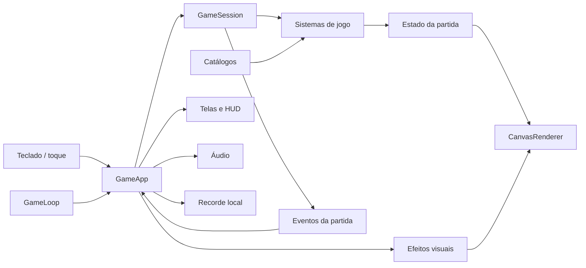

# Arquitetura do NEON RUSH

O jogo usa módulos JavaScript nativos. Não precisa de framework, bundler, servidor de produção ou pacotes externos. A pasta `dist` continua pronta para hospedagem estática no GitHub Pages. O Node serve somente para desenvolvimento e testes.

## Mapa do projeto

```text
dist/
  index.html                 Estrutura das telas
  style.css                  Aparência e adaptação a celular
  js/
    main.js                  Inicialização no navegador
    app.js                   Conecta todos os componentes
    core/
      config.js              Balanceamento e estados da partida
      session.js             Partida, comandos e ordem dos sistemas
      loop.js                Relógio com passos fixos de 1/60 s
      math.js                Cálculos compartilhados
    content/
      enemies.js             Catálogo e criação de inimigos
      upgrades.js            Catálogo e seleção de melhorias
      weapons.js             Estilos de boxe e atributos dos níveis
    systems/
      movement.js            Movimento do jogador e inimigos
      spawning.js            Aparição da horda
      combat.js              Colisões, dano, mortes e energia
      powers.js              Sequência de golpes, choque de ombro e adrenalina
      weapons.js             Direto, jab elástico, Dempsey Roll e Uppercut
      progression.js         Coleta de energia
    platform/
      input.js               Teclado e toque convertidos em um vetor
      audio.js               Adaptador de Web Audio
      storage.js             Adaptador de recordes no navegador
    rendering/
      canvas-renderer.js     Desenha o estado da partida
      effects.js             Partículas, braços elásticos e tremor de câmera
      sprite-atlas.js        Imagens de formas e brilhos calculadas uma vez
      quality.js             Qualidade gráfica adaptada à cadência de quadros
      weapon-renderer.js     Luvas, braço elástico, guarda e impactos
    ui/
      game-view.js           Telas, HUD e escolhas
      format.js              Formatação de tempo e pontos
scripts/
  serve.mjs                  Servidor local restrito a dist/
  check.mjs                  Verifica imports e arquivos públicos
tests/                       Testes das regras, integração e servidor
```

## Como as peças conversam



`GameSession` e os sistemas não acessam `window`, `document`, Canvas ou armazenamento. Recebem o tempo decorrido, o vetor de movimento e o tamanho da tela. A fonte de aleatoriedade é injetada no construtor para permitir simulações reproduzíveis.

O fluxo de cada passo é: mover jogador → gerar inimigos → mover inimigos → atualizar golpes → atualizar poderes → resolver dano/mortes → coletar energia → oferecer evolução. A ordem está explícita em `session.js`.

Os sistemas emitem eventos como `cross`, `jab`, `rollPunch`, `upper`, `kill`, `damaged`, `energy` e `ended`. `GameApp` consome esses eventos para tocar sons, gerar partículas e salvar recordes. Desativar áudio ou mudar o visual não interfere nas regras nem nos números aleatórios usados pela horda.

Estados: `home → playing → paused/upgrade/ended`. Comandos validam o estado atual: não é possível dar dash durante uma pausa nem aplicar uma melhoria que não foi oferecida. Energia acumulada pode oferecer vários níveis, sempre exigindo uma escolha por nível.

`GameLoop` acumula tempo e avança a simulação em passos de 1/60 de segundo. Desenhar a 30, 60 ou 120 FPS mantém a mesma velocidade. Atrasos muito longos são limitados a 0,1 s por quadro; trocar de aba pausa a partida em vez de recuperar o tempo perdido.

O loop fornece ao renderizador a fração de tempo entre passos. As posições anteriores e atuais de jogador, câmera, inimigos, luvas e cristais são interpoladas apenas no desenho, evitando saltos em monitores com cadência diferente de 60 Hz. Colisões e regras continuam usando as posições atuais da simulação.

## Como acrescentar conteúdo

**Balanceamento:** altere `core/config.js`. Duração, velocidade inicial, vida, dash e atributos da arma ficam centralizados.

**Novo inimigo com perseguição:** adicione uma definição em `content/enemies.js`, antes do inimigo normal. Defina `minElapsed`, `threshold`, `radius`, `health`, `healthInterval`, `speed`, `experience` e `visual`. `threshold` é o limite cumulativo de probabilidade, entre 0 e 1; a primeira definição elegível vence. O renderizador usa cor, preenchimento, número de lados e rotação do catálogo. Para comportamentos diferentes de perseguição, acrescente uma estratégia ao sistema de movimento e testes desse comportamento.

**Nova melhoria:** adicione um objeto em `content/upgrades.js` com `id` único, `name`, `symbol`, `desc` e `apply(player)`. Use `available(player)` se houver limite. A seleção e a tela passam a considerar esse objeto automaticamente. Nomes exibidos podem mudar sem quebrar a identificação da melhoria.

Os poderes especiais usam `kind: 'power'`, `stat`, `maxRank` e `describe(player)` para mostrar o próximo nível. A seleção garante ao menos um poder disponível entre as três cartas, sem repetir opções. A mecânica de um novo poder deve ser implementada em um sistema e coberta por testes; adicionar apenas o texto ao catálogo não cria um comportamento de combate.

`content/weapons.js` define os quatro estilos de boxe e funções de atributos. O jab elástico tem o maior alcance, o Direto fica no alcance médio, e Dempsey Roll e Uppercut só acertam de perto; o Uppercut aplica o maior dano. `GameSession.start(weaponId)` valida o identificador e equipa apenas o estilo escolhido no nível 1. A tela inicial passa essa opção à aplicação, e reiniciar mantém a mesma escolha. Estilos adicionais são cartas de `kind: 'weapon'`; melhorias de suporte usam `kind: 'passive'`, pré-requisitos e o mesmo limite de três níveis. Direto, jab, Dempsey Roll e Uppercut podem coexistir.

O Dempsey Roll não gira luvas. A arrancada é o golpe principal: usa a mesma interseção contínua de segmento e acerta cada inimigo atravessado uma única vez por impulso (`dashId`), com dano alto e empurrão. Entre arrancadas, os punhos alternam socos de alcance curto no alvo mais próximo; o braço é apenas animação visual. O Uppercut tem o maior dano e o menor raio; o punho sobe no desenho por 0,32 s, usando o mesmo orçamento de 16 efeitos de arma.

O jab escolhe os inimigos mais próximos dentro do alcance e estica um braço por alvo; o dano resolve no instante do golpe, enquanto a animação elástica de esticar e recolher fica nos efeitos visuais. O Direto acerta apenas o alvo mais próximo com empurrão forte. O Uppercut consulta um círculo e aplica dano e empurrão em todos. Nenhuma arma cria projéteis, e cada ataque ou passo com acerto emite somente eventos visuais. Alcance e Ritmo de luta alteram atributos compartilhados; Atordoamento mantém a velocidade base e aplica um fator temporário. Segundo fôlego é resolvido com as mortes; a Guarda alta é consumida nas colisões e recarregada pelo relógio da partida. Nenhum desses relógios avança durante pausa ou escolha de melhoria.

Direto, jab, Dempsey Roll e Uppercut mantêm o relógio em zero quando estão prontos sem alvos. O intervalo de recarga só é iniciado ao executar um ataque com alvo válido. A seleção do alvo do jab considera o raio do inimigo, como a sua verificação de acerto. O braço do jab usa overshoot na ida e retração quadrática na volta, com curvatura em S. Cada impacto de soco aplica um tremor de tela pequeno; o dano recebido continua sendo o maior tremor.

O Choque de ombro identifica cada arrancada por um contador e só atinge cada inimigo uma vez por arrancada, usando a mesma interseção contínua de segmento. A Sequência de golpes dispara braços elásticos para os alvos mais próximos em um raio e respeita a recarga e o orçamento de animações. A Adrenalina marca o tempo após um nocaute; enquanto durar, as funções de atributos encurtam todas as recargas. Os três poderes são atualizados em `powers.js` e limitados pelos mesmos anéis, partículas e vozes de áudio do restante do jogo.

**Novo efeito:** trate o evento em `rendering/effects.js` ou `platform/audio.js`. Para um novo acontecimento de jogo, emita um evento no sistema responsável. Não coloque lógica de dano dentro do renderizador.

**Novo modo de jogo:** hoje existe apenas sobrevivência por cinco minutos. Para outro objetivo, extraia a condição de término e o balanceamento para uma definição de modo recebida por `GameSession`; mantenha os sistemas que forem comuns. Essa extensão ainda não está implementada.

## Colisões e desempenho

Os golpes percorrem a horda ativa em busca de alvos dentro do alcance; a arena tem no máximo 200 inimigos. O jab verifica a linha do golpe contra cada círculo alcançado; a arrancada do Dempsey Roll compara o segmento percorrido desde o passo anterior. Os socos curtos do Roll, o Uppercut e a Sequência de golpes usam distância ao quadrado até um raio. Não há índice espacial porque não existem projéteis atravessando a arena.

A interseção segmento/círculo considera o caminho inteiro percorrido pelo golpe. Partículas, inimigos, cristais, luvas e animações de braço continuam com limites explícitos.

Cristais recém-gerados recebem `pickupDelay` de 0,3 segundo, definido em `CONFIG.energy.dropDelay`. Durante esse intervalo não são atraídos nem coletados. Depois seguem a regra normal de magnetismo. O desenho combina halo em cache com um corpo vetorial de raio 6 (comum) ou 9 (valioso), contorno claro e centro branco, acima dos inimigos e abaixo do jogador. A redução de qualidade afeta o halo, sem suprimir o corpo do cristal.

O limite da horda começa em 40 e cresce até 200 em 210 segundos. O intervalo entre aparições diminui de 0,85 para 0,16 segundo ao longo de 270 segundos. Uma partida maior gera mais inimigos no total, sem manter todos os inimigos já gerados em memória.

`CONFIG.difficulty` configura elites e invasões. A partir de 45 segundos, um tanque elite pode ocupar uma vaga normal na próxima geração: tem 3× a vida do tanque da mesma etapa, raio 25% maior, velocidade 12% maior, recompensa 4× maior e dois pontos de dano por contato. Há no máximo três elites vivos e ao menos 45 segundos entre suas aparições. O halo existente é dimensionado, sem criar novas variantes em cache. Um contorno dourado e uma barra mostram sua condição.

A partir de 60 segundos, os primeiros 12 segundos de cada minuto multiplicam o intervalo de geração por 0,72. São invasões com avisos de início, mantendo o limite de inimigos. Elites e invasões emitem eventos para a apresentação; a geração não acessa DOM ou áudio.

Os limites estão em `CONFIG`: 200 inimigos, 700 cristais, até 180 partículas e 16 braços visuais. As partículas sobreviventes são compactadas no mesmo array.

O renderizador descarta desenhos fora da área visível com margem e limita o Canvas a 1 milhão de pixels e DPR de 1,25. As 18 variantes de halos e cristais são preparadas em pequenos Canvas antes da partida. O Canvas principal copia esses halos sem recalcular desfoque por objeto e desenha o boxeador roxo, as luvas vermelhas e os inimigos como vetores. O núcleo do personagem gira no sentido oposto ao corpo. Marcas da grade são desenhadas em lotes. O teste com navegador simulado valida o uso do cache, mas não mede seu custo real na GPU.

`RenderQuality` observa intervalos de quadros durante a partida. Depois de ao menos 1,5 segundo e 30 amostras com média acima de 24 ms, reduz um nível. Os níveis solicitam escalas de resolução de 1, 0,8 e 0,65 e limites de partículas de 180, 108 e 54. A resolução resultante nunca desce abaixo de DPR 1, exceto se o teto de pixels já obrigar isso em uma tela muito grande. A recuperação exige pelo menos 10 segundos de janelas estáveis com média abaixo de 18 ms. Pausas não entram nessa medição. Acima de 100 inimigos ou nos níveis reduzidos, os cristais usam imagens sem brilho; personagem e inimigos mantêm seus halos pré-calculados, contornos e núcleos. Nenhuma dessas decisões elimina inimigos, altera colisões ou muda a dificuldade.

A interface só reescreve os valores que mudaram. O áudio limita vozes simultâneas a oito e agrupa coletas ocorridas em intervalos curtos, desconectando os nós ao terminar. A vinheta sobreposta fica oculta durante a partida, e as janelas não usam filtro de desfoque sobre o cenário.

## Testes e limites

`npm test` usa o executor nativo do Node. Os testes importam os módulos reais, sem modificar strings de código ou expor variáveis privadas por substituição. A suíte cobre estados, isolamento de partidas, movimento, dash, upgrades, colisões, recordes bloqueados, taxas de quadros, ciclo de vida da aplicação e respostas HTTP.

O teste de integração usa uma interface de navegador simulada e IDs do HTML real. Ele não substitui teste visual em navegador nem teste de toque em um aparelho real.

A arquitetura organiza e permite ampliar um jogo de um jogador. Não inclui multiplayer, servidor autoritativo, contas, ranking online ou persistência na nuvem. Esses recursos exigiriam componentes adicionais.
